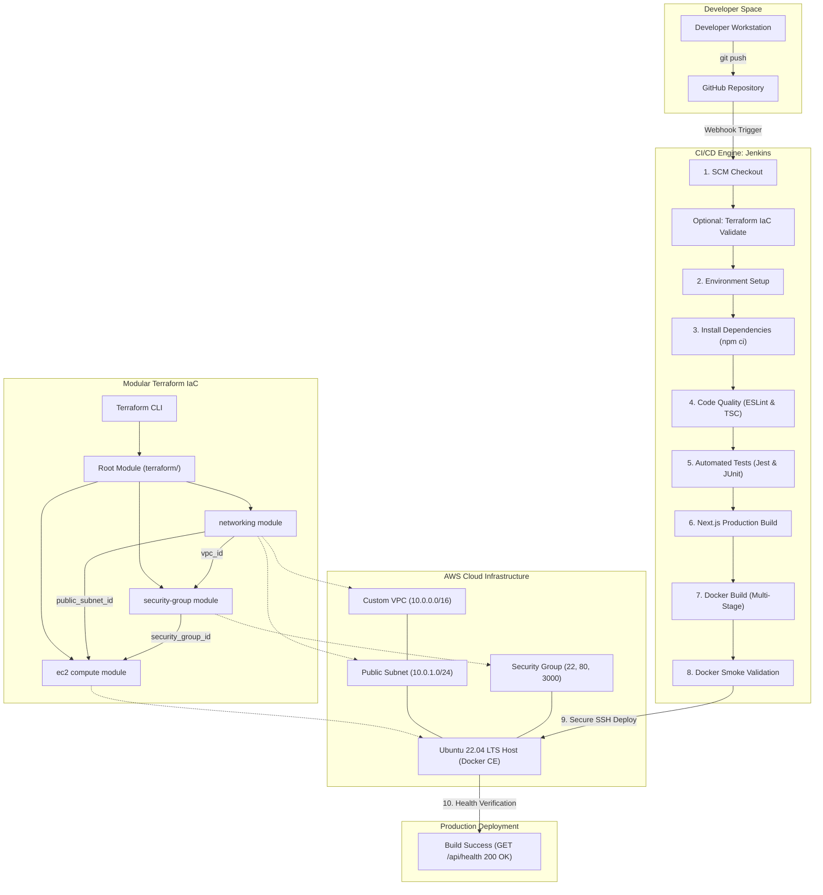

# DevOps CI/CD Automation Dashboard & Terraform Modular Infrastructure as Code

[](https://nextjs.org/)
[](https://www.typescriptlang.org/)
[](https://www.jenkins.io/)
[](https://www.docker.com/)
[](https://www.terraform.io/)
[](https://aws.amazon.com/)
[](LICENSE)

---

## 1. Abstract

This academic and production-grade DevOps project provides a complete, automated end-to-end continuous integration, continuous delivery (CI/CD), and Infrastructure as Code (IaC) deployment framework. Using a lightweight, responsive Next.js 14 (App Router & TypeScript) operational monitoring dashboard (**DevOps CI/CD Automation Dashboard**), this project demonstrates how modern cloud-native engineering principles decouple application development, infrastructure provisioning, automated testing, container orchestration, and remote server configuration into a robust, repeatable software supply chain.

Infrastructure is defined declaratively using HashiCorp Terraform following a strictly decoupled **Root Module + Reusable Child Modules** architecture targeting Amazon Web Services (AWS). Continuous integration and continuous delivery are driven by a **10-stage declarative Jenkins pipeline**, executing static code analysis, strict type verification, automated unit/integration testing with JUnit XML reporting, multi-stage Docker image building, ephemeral local container smoke testing, and zero-downtime SSH-authenticated container deployment onto an AWS EC2 instance.

---

## 2. Problem Statement

Modern enterprise software development requires rapid iteration while preserving reliability, security, and traceability. In many legacy environments:
1. **Manual Server Configuration**: Leads to "snowflake servers", configuration drift, and unreproducible staging/production environments.
2. **Brittle Release Processes**: Manual handoffs between developers and operations cause deployment delays, unverified builds, and downtime.
3. **Hardcoded Credentials & Security Risks**: Embedding API secrets or SSH private keys directly in scripts exposes organizations to credential theft.
4. **Monolithic Infrastructure Scripts**: Lack of modularity in IaC causes circular dependencies and tight coupling across network, firewall, and compute layers.

This project addresses these challenges by delivering an automated, audited, and isolated CI/CD and IaC reference implementation.

---

## 3. Project Objectives

- **Automated CI/CD**: Design and implement a robust 10-stage declarative `Jenkinsfile` managing the lifecycle from Git commit to cloud verification.
- **Modular IaC**: Implement Terraform utilizing a Root Module orchestrating three child modules (`networking`, `security-group`, and `ec2`) with dynamic Ubuntu AMI resolution.
- **Containerization**: Build a secure, lightweight multi-stage Docker image using `node:20-alpine`, non-root execution (`USER nextjs`), and Next.js standalone tracing.
- **Automated Verification**: Implement unit and REST API integration tests using Jest with automated JUnit XML reporting (`junit.xml`).
- **Secure Secret Handling**: Ensure zero hardcoded credentials, leveraging Jenkins Credentials Binding (`sshUserPrivateKey`) and Terraform variable abstraction.
- **Comprehensive Documentation**: Provide detailed runbooks, presentation scripts, and an 18-point screenshot submission checklist.

---

## 4. Technology Stack

| Layer | Component | Version / Specification | Purpose |
|---|---|---|---|
| **Frontend** | Next.js (App Router) | `14.2.x` | Lightweight operational dashboard & UI |
| **Language** | TypeScript | `5.7.x` | Strict type safety and compile-time validation |
| **Testing** | Jest & Testing Library | `29.7.x` | Unit, integration & DOM testing |
| **Reporting** | Jest-JUnit | `16.0.x` | Standardized XML test reports for Jenkins |
| **Linting** | ESLint | `8.57.x` | Static code analysis & best practices |
| **Version Control**| Git / GitHub | `2.49+` | Distributed SCM and webhook triggers |
| **CI/CD Engine**| Jenkins (Declarative) | `2.4x+` LTS | 10-stage automated delivery pipeline |
| **Container Engine**| Docker CE | `20-alpine base` | Multi-stage, non-root isolated container runtime |
| **Local Orchestration**| Docker Compose | `3.8 spec` | Multi-container local execution |
| **IaC** | HashiCorp Terraform | `>= 1.5.0` | Modular cloud infrastructure provisioning |
| **Cloud Provider**| Amazon Web Services (AWS)| `AWS Provider ~> 5.0` | Custom VPC, Subnet, IGW, Security Group, EC2 |
| **Host OS** | Ubuntu Linux | `22.04 LTS (Jammy)` | Target EC2 cloud compute host |

---

## 5. System Architecture & CI/CD Workflow



---

## 6. Jenkins Declarative CI/CD Pipeline

The `Jenkinsfile` at the repository root implements a robust, declarative pipeline with parameterization and comprehensive post-actions:

```groovy
pipeline {
    agent any
    options {
        timeout(time: 30, unit: 'MINUTES')
        timestamps()
        buildDiscarder(logRotator(numToKeepStr: '10'))
        ansiColor('xterm')
    }
    ...
```

### The 10 Mandatory Stages:

1. **Stage 1: Checkout Source Code**: Clones the GitHub repository, logs commit hash (`GIT_COMMIT_SHORT`), branch name, and verifies Git connectivity.
2. **Stage 2: Environment Setup**: Validates Node.js (`v20+`), npm (`v10+`), Docker CLI, and Docker daemon socket connectivity.
3. **Stage 3: Install Dependencies**: Enforces strict, reproducible dependency installation via `npm ci` based on `package-lock.json`.
4. **Stage 4: Code Quality and Validation**: Runs ESLint static analysis and TypeScript strict type checking (`tsc --noEmit`). Fails pipeline upon any typing or syntax errors.
5. **Stage 5: Automated Testing**: Executes Jest unit and API integration tests. Generates and archives `junit.xml` test reports.
6. **Stage 6: Production Build**: Executes `npm run build` to generate optimized Next.js production output and standalone artifacts.
7. **Stage 7: Docker Build**: Builds the multi-stage Docker container tagged with `${IMAGE_NAME}:${BUILD_NUMBER}-${GIT_COMMIT_SHORT}` and `${IMAGE_NAME}:latest`.
8. **Stage 8: Docker Validation**: Spins up an ephemeral local container on test port `3001`, curls `/api/health`, verifies HTTP 200 and `"status":"healthy"`, then cleanly stops and removes the container.
9. **Stage 9: Deployment to AWS EC2**: Securely injects SSH private key via Jenkins Credentials Binding (`sshUserPrivateKey`), transfers Docker container archive to the EC2 instance, restarts container on ports 80 and 3000, and verifies remote container execution.
10. **Stage 10: Post-Deployment Verification**: Performs live HTTP health verification against `http://${EC2_HOST}/api/health`, logs public deployment URLs, and marks build as successful.

---

## 7. Modular Terraform Architecture

Infrastructure is managed under `terraform/` using an enterprise **Root Module + Reusable Child Modules** pattern:

```text
terraform/
├── main.tf                    # Root module orchestrating child modules
├── provider.tf                # AWS provider and global tags
├── versions.tf                # Terraform >= 1.5.0, AWS provider ~> 5.0
├── variables.tf               # Root input variables with defaults and validations
├── outputs.tf                 # Exposes public IP, DNS, application URL, and IDs
├── terraform.tfvars.example   # Example variables template
├── .gitignore                 # Excludes state files, local configs, and secrets
│
└── modules/
    ├── networking/            # Custom VPC, Internet Gateway, Public Subnet, Route Tables
    ├── security-group/        # Inbound SSH (22), HTTP (80), App (3000), Outbound egress
    └── ec2/                   # Dynamic Ubuntu 22.04 LTS AMI, EC2 instance, user_data.sh
```

### Module Responsibilities & Dependency Flow:
1. **`modules/networking`**: Provisions an isolated VPC (`10.0.0.0/16`), an Internet Gateway, and a public subnet (`10.0.1.0/24`) with automatic public IP mapping. Outputs `vpc_id` and `public_subnet_id`.
2. **`modules/security-group`**: Consumes `vpc_id` and establishes ingress firewall rules for SSH (restricted CIDR), HTTP (port 80), and App (port 3000). Outputs `security_group_id`.
3. **`modules/ec2`**: Consumes `public_subnet_id` and `security_group_id`, dynamically resolves the latest official Ubuntu 22.04 LTS AMI from Canonical (`099720109477`), provisions the EC2 instance, and executes `user_data.sh` to install and configure Docker CE. Outputs `public_ip` and `instance_id`.

---

## 8. Docker Implementation & Optimization

The application utilizes a **3-stage multi-stage Dockerfile**:

```dockerfile
# Stage 1: Base & Dependencies (Alpine)
FROM node:20-alpine AS deps
...
RUN npm ci

# Stage 2: Builder
FROM node:20-alpine AS builder
...
RUN npm run build

# Stage 3: Runner (Production)
FROM node:20-alpine AS runner
...
RUN addgroup --system --gid 1001 nodejs && adduser --system --uid 1001 nextjs
COPY --from=builder --chown=nextjs:nodejs /app/.next/standalone ./
COPY --from=builder --chown=nextjs:nodejs /app/.next/static ./.next/static
USER nextjs
EXPOSE 3000
CMD ["node", "server.js"]
```

### Key Engineering Features:
- **Minimal Attack Surface**: Based on lightweight `node:20-alpine`.
- **Non-Root Execution**: Runs under unprivileged user `nextjs` (UID 1001) to prevent container escape exploits.
- **Standalone Tracing**: Copies only traced production files from `.next/standalone`, reducing container image size by over 80%.
- **Healthcheck Directive**: Docker native healthcheck polling `/api/health` every 30 seconds.

---

## 9. Project Directory Structure

```text
devops-cicd-terraform/
├── app/
│   ├── api/
│   │   └── health/
│   │       └── route.ts       # REST API Health Endpoint (GET /api/health)
│   ├── globals.css            # Responsive dark-theme dashboard CSS
│   ├── layout.tsx             # Root layout with HTML/Head metadata
│   └── page.tsx               # Dashboard UI with live status & pipeline stages
├── public/
│   └── robots.txt             # Public web crawler directives
├── tests/
│   ├── api.test.ts            # REST API health endpoint Jest test suite
│   └── page.test.tsx          # Dashboard UI component React Testing Library tests
├── terraform/
│   ├── modules/
│   │   ├── ec2/
│   │   │   ├── main.tf
│   │   │   ├── outputs.tf
│   │   │   ├── user_data.sh   # EC2 Docker Engine bootstrap script
│   │   │   └── variables.tf
│   │   ├── networking/
│   │   │   ├── main.tf
│   │   │   ├── outputs.tf
│   │   │   └── variables.tf
│   │   └── security-group/
│   │       ├── main.tf
│   │       ├── outputs.tf
│   │       └── variables.tf
│   ├── .gitignore
│   ├── main.tf
│   ├── outputs.tf
│   ├── provider.tf
│   ├── README.md              # Dedicated Terraform modular documentation
│   ├── terraform.tfvars.example
│   ├── variables.tf
│   └── versions.tf
├── docs/
│   ├── DEPLOYMENT_GUIDE.md    # End-to-end integration and operations manual
│   ├── DEMONSTRATION_SCRIPT.md# 5-7 minute presentation script with explanations
│   ├── JENKINS_SETUP.md       # Jenkins installation, plugins, & webhook guide
│   ├── SCREENSHOT_CHECKLIST.md# 18 mandatory submission screenshots checklist
│   └── TERRAFORM_GUIDE.md     # Terraform CLI commands & state management guide
├── screenshots/
│   └── README.md              # Organization guide for submission screenshots
├── .dockerignore              # Excludes node_modules, .next, terraform from Docker context
├── .eslintrc.json             # ESLint configuration
├── .gitignore                 # Excludes node_modules, build outputs, state files
├── docker-compose.yml         # Local container orchestration manifest
├── Dockerfile                 # Production multi-stage Docker build manifest
├── Jenkinsfile                # 10-stage declarative Jenkins pipeline
├── jest.config.js             # Jest testing configuration with JUnit reporter
├── jest.setup.js              # Testing Library DOM matchers setup
├── next.config.mjs            # Next.js standalone output configuration
├── package.json               # Dependencies and execution scripts
├── package-lock.json          # Deterministic dependency lockfile
├── tsconfig.json              # TypeScript compiler configuration
└── README.md                  # Master project documentation
```

---

## 10. Local Setup & Execution Instructions

### Prerequisites
- Node.js `20.x` or `22.x`
- npm `10.x`
- Docker Desktop
- Terraform CLI `1.5+`

### Step 1: Install Dependencies
```bash
npm install
```

### Step 2: Run Development Server
```bash
npm run dev
```
Open `http://localhost:3000` to view the running dashboard.

### Step 3: Run Validation & Test Suites
```bash
# TypeScript strict type check
npm run type-check

# ESLint analysis
npm run lint

# Automated Jest unit and API integration tests
npm test
```

### Step 4: Run Production Build Locally
```bash
npm run build
npm run start
```

### Step 5: Run with Docker Compose
```bash
docker compose up --build -d
curl http://localhost:3000/api/health
docker compose down
```

---

## 11. Cloud Infrastructure & CI/CD Deployment

### Step 1: Provision AWS Infrastructure via Terraform
```bash
cd terraform
terraform init
terraform fmt -recursive
terraform validate

# Create your variables file
cp terraform.tfvars.example terraform.tfvars
# Update key_name = "<your-aws-keypair-name>"

terraform plan -out=tfplan
terraform apply tfplan

# Note the public IP:
terraform output public_ip
```

### Step 2: Push to GitHub & Trigger Jenkins
```bash
git add .
git commit -m "feat: complete automated DevOps CI/CD and Terraform IaC pipeline"
git push origin main
```
1. Open Jenkins and select the `DevOps-CICD-Dashboard` pipeline.
2. Click **Build with Parameters**.
3. Set `DEPLOY_TO_EC2 = true` and `EC2_HOST = <EC2-PUBLIC-IP>`.
4. Click **Build** and observe the 10 stages executing in sequence.

### Step 3: Decommissioning Cloud Infrastructure (Teardown)
To prevent unexpected AWS charges after testing or recording your demonstration:
```bash
cd terraform
terraform destroy -auto-approve
```

---

## 12. Verification & API Health Check

The application exposes an automated health verification endpoint at `GET /api/health`:

```bash
curl -i http://<EC2-PUBLIC-IP>/api/health
```

Expected HTTP Response:
```json
HTTP/1.1 200 OK
Content-Type: application/json; charset=utf-8
Cache-Control: no-store, max-age=0

{
  "status": "healthy",
  "application": "devops-cicd-dashboard",
  "timestamp": "2026-11-05T10:15:35.000Z",
  "uptime": 128.45
}
```

---

## 13. Screenshots & Demonstration Deliverables

All 18 required submission screenshots should be placed in the `screenshots/` directory. Refer to [docs/SCREENSHOT_CHECKLIST.md](docs/SCREENSHOT_CHECKLIST.md) for full descriptions and capturing instructions:

- `01_github_repository_overview.png`
- `02_application_running_locally.png`
- `03_jenkins_dashboard.png`
- `04_jenkins_pipeline_configuration.png`
- `05_jenkinsfile_inside_repository.png`
- `06_jenkins_pipeline_successful_execution.png`
- `07_individual_pipeline_stages.png`
- `08_automated_test_results.png`
- `09_docker_image_creation.png`
- `10_running_docker_container.png`
- `11_terraform_configuration_files.png`
- `12_terraform_init_output.png`
- `13_terraform_validate_output.png`
- `14_terraform_plan_output.png`
- `15_terraform_apply_output.png`
- `16_aws_ec2_instance_dashboard.png`
- `17_application_running_on_ec2.png`
- `18_final_successful_deployment.png`

For the 5–7 minute video presentation, follow the structured script in [docs/DEMONSTRATION_SCRIPT.md](docs/DEMONSTRATION_SCRIPT.md).

---

## 14. Conclusion

This project successfully proves the end-to-end synergy between **Jenkins Continuous Integration/Continuous Deployment** and **Terraform Infrastructure as Code**. By adhering to declarative pipelines, modular architecture, container security best practices, and automated testing gates, the delivery process achieves zero manual intervention, deterministic repeatability, and audit compliance suitable for modern cloud-native enterprises.

