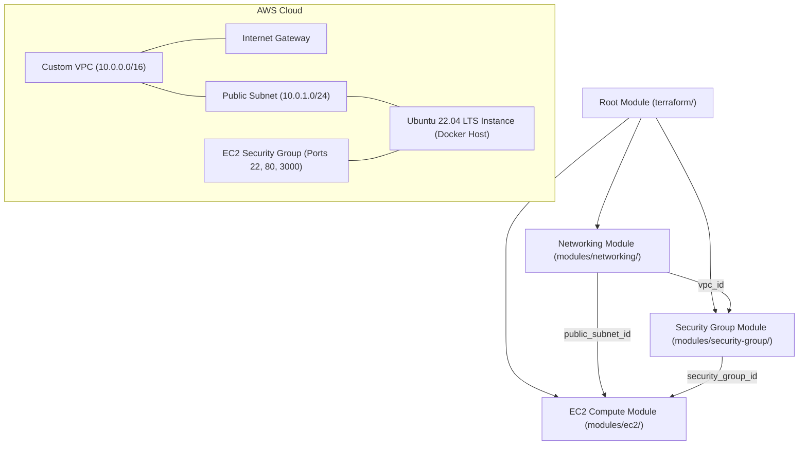

# Modular Terraform Infrastructure as Code (AWS)

## 1. Overview & Architecture Philosophy

This directory contains the complete Infrastructure as Code (IaC) configuration for provisioning the production hosting environment for the **DevOps CI/CD Automation Dashboard**.

Rather than placing all resources into a single monolithic `main.tf` file, this project strictly adopts an enterprise-grade **Root Module + Reusable Child Modules** architecture:

1. **Separation of Concerns**: Networking, Security, and Compute are isolated into dedicated, purpose-built modules.
2. **Reusability & Modularity**: Each child module can be tested, extended, and instantiated across multiple environments (`dev`, `staging`, `production`).
3. **Least Privilege & Explicit Dependency Graph**: Information flows deterministically between modules using standard input variables and outputs, avoiding hardcoded values or implicit coupling.

---

## 2. Infrastructure Architecture & Module Dependency Flow

The infrastructure is provisioned on Amazon Web Services (AWS) using the following dependency graph:



### Module Data Flow:
1. `modules/networking` provisions the custom VPC, Internet Gateway, public subnet, and route tables. It outputs `vpc_id` and `public_subnet_id`.
2. `modules/security-group` receives `vpc_id` as an input and provisions the security group for SSH and application traffic. It outputs `security_group_id`.
3. `modules/ec2` receives `public_subnet_id` and `security_group_id`, dynamically resolves the latest official Ubuntu 22.04 LTS AMI, and bootstraps the Docker runtime via `user_data.sh`.
4. The **Root Module** orchestrates these variables and presents outputs (`public_ip`, `application_url`, `instance_id`).

---

## 3. Directory Structure

```text
terraform/
├── main.tf                    # Root module orchestrating child modules
├── provider.tf                # AWS provider configuration & default tags
├── versions.tf                # Terraform and AWS provider version constraints
├── variables.tf               # Root input variable definitions & defaults
├── outputs.tf                 # Root outputs exposing IPs, IDs, and URLs
├── terraform.tfvars.example   # Example configuration parameters
├── .gitignore                 # Excludes state files, local configs, and secrets
│
├── modules/
│   ├── networking/            # VPC, Subnet, Route Table, and IGW
│   │   ├── main.tf
│   │   ├── variables.tf
│   │   └── outputs.tf
│   │
│   ├── security-group/        # Inbound SSH, HTTP, App port & Outbound rules
│   │   ├── main.tf
│   │   ├── variables.tf
│   │   └── outputs.tf
│   │
│   └── ec2/                   # Dynamic Ubuntu AMI, EC2 instance, User Data
│       ├── main.tf
│       ├── variables.tf
│       ├── outputs.tf
│       └── user_data.sh       # Docker Engine & host bootstrapping script
│
└── README.md                  # This documentation
```

---

## 4. Child Module Responsibilities

### Module 1: `modules/networking`
- **Purpose**: Creates an isolated virtual network in AWS.
- **Resources**:
  - `aws_vpc`: Dedicated VPC with DNS hostnames and resolution enabled.
  - `aws_internet_gateway`: Gateway enabling internet routing.
  - `aws_subnet`: Public subnet with automatic public IPv4 address assignment.
  - `aws_route_table`: Public routing table directing `0.0.0.0/0` traffic to the Internet Gateway.
  - `aws_route_table_association`: Binds public subnet to the public route table.
- **Inputs**: `vpc_cidr`, `public_subnet_cidr`, `availability_zone`, `project_name`, `environment`.
- **Outputs**: `vpc_id`, `public_subnet_id`, `internet_gateway_id`.

### Module 2: `modules/security-group`
- **Purpose**: Implements firewall and access boundaries following least-privilege principles.
- **Resources**:
  - `aws_security_group`: Attached directly to the custom VPC.
  - Ingress Rule 1: SSH (Port 22) restricted to configurable CIDR (`var.ssh_allowed_cidr`).
  - Ingress Rule 2: HTTP (Port 80) open for web traffic.
  - Ingress Rule 3: Application Port (Port 3000) open for direct container health checks and access.
  - Egress Rule: Full outbound access (`0.0.0.0/0`) for OS updates and container image pulls.
- **Inputs**: `vpc_id`, `project_name`, `environment`, `ssh_allowed_cidr`, `app_port`.
- **Outputs**: `security_group_id`.

### Module 3: `modules/ec2`
- **Purpose**: Provisions the compute instance and initializes the container execution runtime.
- **Resources**:
  - `data.aws_ami.ubuntu`: Dynamically queries the latest official Canonical Ubuntu 22.04 LTS AMI.
  - `aws_instance`: EC2 instance with encrypted gp3 root block storage, key pair attachment, and security group association.
  - `user_data.sh`: Automated shell bootstrap script executed at first boot. Installs Docker CE, Docker Compose plugin, starts the Docker daemon, and adds `ubuntu` user to the `docker` group.
- **Inputs**: `instance_type`, `subnet_id`, `security_group_id`, `key_name`, `root_volume_size`, `project_name`, `environment`.
- **Outputs**: `instance_id`, `public_ip`, `public_dns`, `private_ip`.

---

## 5. Execution Workflow & CLI Commands

Follow these standardized commands to manage the infrastructure lifecycle:

### Step 1: Initialize Working Directory
Downloads provider plugins (AWS) and initializes child module symlinks.
```bash
terraform init
```

### Step 2: Format Code Recursively
Ensures all HCL files adhere to standard Terraform canonical formatting.
```bash
terraform fmt -recursive
```

### Step 3: Validate Configuration
Checks configuration syntax, variable bindings, and resource dependencies without contacting AWS.
```bash
terraform validate
```

### Step 4: Generate Execution Plan
Previews the exact changes Terraform will make against your AWS account.
```bash
terraform plan -out=tfplan
```

### Step 5: Provision Infrastructure (Requires Approval)
Applies the planned changes to create the VPC, security groups, and EC2 instance.
```bash
terraform apply tfplan
```

### Step 6: View Infrastructure Outputs
Displays the assigned public IP, DNS name, and application URL.
```bash
terraform output
```

### Step 7: Teardown Infrastructure (Cleanup)
Destroys all created AWS resources to prevent unnecessary cloud costs.
```bash
terraform destroy
```

---

## 6. State Management & Security Best Practices

1. **No Hardcoded Credentials**: Never write `access_key` or `secret_key` in `.tf` files. Terraform automatically uses AWS standard credentials from `~/.aws/credentials`, environment variables (`AWS_ACCESS_KEY_ID`, `AWS_SECRET_ACCESS_KEY`), or EC2 IAM Instance Profiles.
2. **State Protection**: `.gitignore` is configured to prevent committing `terraform.tfstate`, `terraform.tfstate.backup`, and `*.tfvars` containing secrets.
3. **Remote State Recommendations**: In enterprise production, configure an S3 backend with DynamoDB state locking:
   ```hcl
   # Example production backend block:
   # backend "s3" {
   #   bucket         = "my-terraform-state-bucket"
   #   key            = "devops-cicd/terraform.tfstate"
   #   region         = "us-east-1"
   #   dynamodb_table = "terraform-locks"
   #   encrypt        = true
   # }
   ```
4. **Least Privilege Inbound Rules**: For production environments, always set `ssh_allowed_cidr` to your specific corporate VPN or workstation IP CIDR (e.g. `203.0.113.50/32`) instead of `0.0.0.0/0`.

